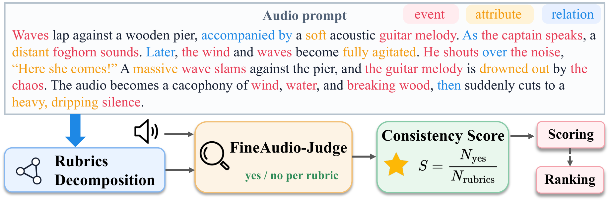
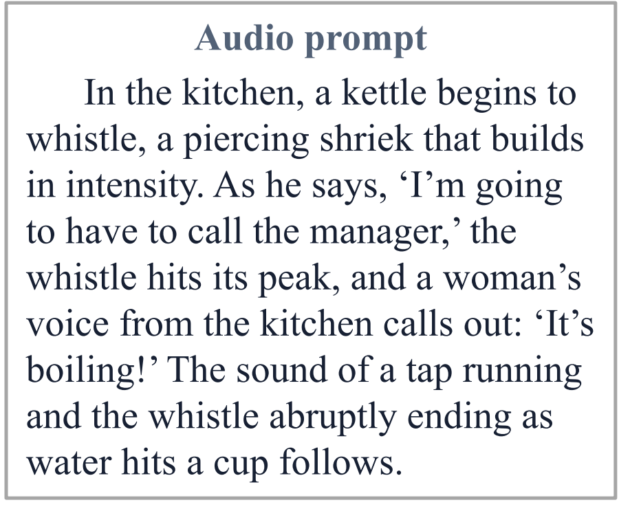
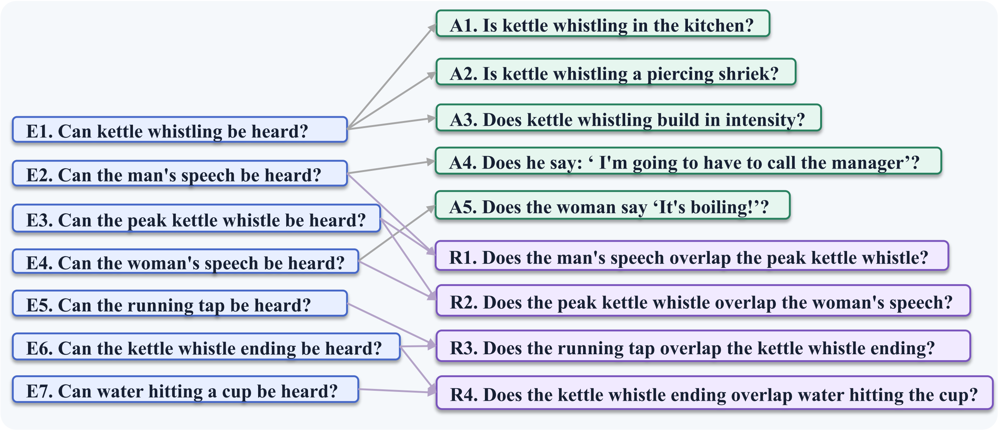
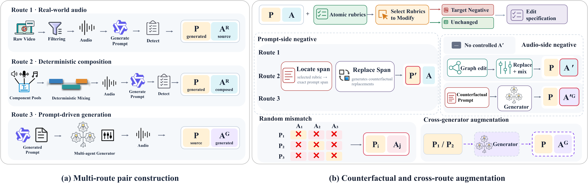

# FineAudio-Judge

> A Fine-Grained Evaluation Framework for Complex Text-to-Audio Generation

**Authors:** Zixuan Chen, Haoxu Wang, Shimin Zhang, Bin Yu, Menglong Xu,
Biao Tian, Xiangang Li, and Hao Zhang

## Abstract

Recent advances in instruction-guided audio generation make fine-grained evaluation of complex long-form audio increasingly challenging. Existing evaluators improve interpretability through question decomposition, but flat rubric generation offers limited control over coverage and granularity, while reliable judgment requires fine-grained acoustic supervision. We introduce **FineAudio-Judge**, which structures instructions into events, attributes, and inter-event relations, and compiles them into atomic tuples and independently assessable binary rubrics. We further construct a multi-route training corpus covering real, composed, and generated audio, with rubric-guided prompt/audio perturbations and cross-sample mismatches for training a dedicated judge. Experiments show improved fine-grained judgement and stronger agreement with human preferences. 

## Resources

| Resource | Link |
|---|---|
| Paper | --- |
| Code | [GitHub](https://github.com/QwenAudio/FunResearch/tree/main/FineAudio-Judge) |
| Model | [HuggingFace](https://huggingface.co/Zixchen/FineAudio-Judge) |
| Benchmark | [Benchmark](https://huggingface.co/datasets/Zixchen/FineAudio-Judge-Benchmark) |

## Overview

FineAudio-Judge targets complex and long-form audio prompts that jointly
specify multiple acoustic events, their attributes, and temporal or
compositional relations. It organizes these requirements into an event-centered
audio scene graph and compiles validated graph elements into atomic tuples and
independently answerable binary rubrics.

<p align="center">
  
</p>

Given an audio-prompt pair, FineAudio-Judge predicts `yes` or `no` for every
rubric. The proportion of `yes` judgments forms an interpretable consistency
score that can be used for scoring and candidate ranking.

## Highlights

- **Structured rubric decomposition:** organizes prompts into events,
  attributes, and inter-event relations, then compiles them into
  atomic binary rubrics.

- **Multi-route fine-grained supervision:** combines real-world audio,
  deterministic composition, and prompt-driven generation with
  rubric-guided prompt/audio counterfactuals and cross-sample
  mismatches.

- **Dedicated audio judge:** trains a Qwen3-Omni-based judge for
  rubric-level decisions, consistency scoring, and candidate ranking.

## Implementation

The repository provides three core implementation modules:

| Component | Purpose |
|---|---|
| `rubric_decomposition/` | Structured prompt decomposition into scene graphs, atomic tuples, dependencies, and binary rubrics |
| `data_pipeline/` | Multi-route pair construction and rubric-guided counterfactual supervision |
| `judge/` | Rubric-level inference, consistency scoring, and benchmark evaluation |

## Data and benchmark

The training corpus contains 12,508 audio-prompt pairs and 347,168
rubric-level judgments. After deduplication and conflict removal, 278,199
rubric instances are used for training and 15,440 for validation. These
training records are distinct from the evaluation benchmark.

The evaluation benchmark contains:

- **Rubric-QA:** 700 audio samples from seven subsets and 33,498 binary
  rubrics. Five model annotations per rubric are aggregated by majority vote
  to produce the reference label.
- **Human Preference:** 100 prompts, 300 generated candidates, and rankings
  from seven human annotators. The paper reports results on 84 groups with a
  unique modal ranking and 279 pairs with a unique modal preference.

## Installation

Python 3.10 or later is required.

```bash
git clone https://github.com/QwenAudio/FunResearch.git
cd FunResearch/FineAudio-Judge
pip install -e ".[judge]"
```

Use `pip install -e .` instead if judge inference is not needed.

Data-construction model backends require additional dependencies:

```bash
pip install -r data_pipeline/requirements.txt
```

Audio-Oscar uses a separate environment and external checkout. See the
[data-construction guide](data_pipeline/README.md) for configuration.

## Usage

### 1. Rubric decomposition

Rubric decomposition converts one audio prompt into event, attribute, and
relation rubrics. The reference backend is a user-hosted Qwen/vLLM-compatible
Chat Completions endpoint. It must support JSON-object output with thinking
disabled, and the tokenizer must match the served model.

<p align="center">
  
  
</p>
<p align="center"><em>Rubric decomposition example: input prompt (left) and FineAudio-Judge rubrics (right).</em></p>

```bash
python -m judge.cli.decompose_prompt \
  --prompt-file examples/example_prompt.txt \
  --base-url http://127.0.0.1:8000/v1 \
  --model YOUR_DECOMPOSITION_MODEL \
  --tokenizer YOUR_TOKENIZER_ID_OR_PATH \
  --checkpoint-dir outputs/decomposition_audit \
  --output outputs/rubrics.json
```

The output contains the scene graph, atomic tuples, tuple dependencies, and
binary rubrics. The audit directory records the resolved configuration, stage
checkpoints, LLM instructions, retry attempts, and final structural validation.

### 2. Data construction

<p align="center">
  
</p>
<p align="center"><em>FineAudio-Judge corpus construction pipeline: (a) multi-route pair construction and (b) counterfactual and cross-route augmentation. Here, P and P′ denote the original and counterfactual prompts, respectively. A denotes audio, with A<sub>R</sub> and A<sub>G</sub> representing real and generated audio, respectively, and A′ denoting counterfactual audio. Subscripts i, j ∈ {1, 2, 3} index the three construction routes.</em></p>

The training data are constructed through three positive-pair routes,
rubric-guided counterfactuals, cross-route generation, and constrained
mismatch pairing. See the [data-construction guide](data_pipeline/README.md)
for inputs, configurations, entry points, and outputs.

See [examples](examples/README.md) for 30 audio–prompt pairs from the
three training-data construction routes, organized by data-license category:

- [A1](examples/audio_prompt_pairs/A1/): five FineVideo-derived Route 1 examples.
- [A2](examples/audio_prompt_pairs/A2/): five Vript-derived Route 1 examples,
  ten Route 2 composition examples, and ten Route 3 Audio-Oscar-generated examples.

#### Route 1: Real-world audio

[Route 1](data_pipeline/README.md) extracts native audio
from real-world videos, filters it for acoustic richness and event clarity, and
generates audio-grounded captions. Its negative pipeline replaces prompt spans
associated with selected rubrics while keeping the original audio unchanged.

#### Route 2: Deterministic composition

[Route 2](data_pipeline/README.md) samples
annotated sound-event and speech components, builds a construction graph, and
deterministically mixes the audio. It supports prompt-side negatives and
audio-side negatives produced by replacing components or editing temporal
relations before remixing.

#### Route 3: Prompt-driven generation

[Route 3](data_pipeline/README.md) generates
audio-centered complex-scene prompts and synthesizes them with the pinned
Audio-Oscar workflow. Its negative pipeline creates prompt-side counterfactuals
and resynthesizes audio-side counterfactuals from edited specifications.

#### Additional construction methods

[Additional construction methods](data_pipeline/README.md)
provides cross-generator samples by regenerating Route 1 and Route 2 prompts
with Audio-Oscar, as well as constrained within-route and cross-route mismatch
pairs.

### 3. FineAudio-Judge

FineAudio-Judge evaluates each rubric against the audio and predicts `yes` or
`no`. Each JSONL manifest row must contain `sample_id`, `audio_path`, and a
non-empty `questions` list. Every question requires a unique `rubric_id` (or
`id`) and a non-empty `question`; `subtype` is optional.

```json
{"sample_id":"demo-001","audio_path":"/path/to/audio.wav","questions":[{"rubric_id":"E1","subtype":"event","question":"Can waves be heard?"}]}
```

#### Joint-rubric inference

Joint-rubric inference evaluates all rubrics for one audio sample in
deterministically ordered chunks. It returns per-rubric predictions and the
audio-prompt consistency score, defined as the proportion of rubrics predicted
as `yes`.

```bash
python -m judge.cli.infer_batch_rubrics \
  --manifest /path/to/manifest.jsonl \
  --model Qwen/Qwen3-Omni-30B-A3B-Instruct \
  --adapter /path/to/FineAudio-Judge-Model \
  --output outputs/joint_rubric_predictions.jsonl
```

#### Single-rubric inference

Single-rubric inference sends one rubric per model request and is used for
rubric-level accuracy and yes/no recall.

```bash
python -m judge.cli.infer_single_rubric \
  --manifest /path/to/manifest.jsonl \
  --model Qwen/Qwen3-Omni-30B-A3B-Instruct \
  --adapter /path/to/FineAudio-Judge-Model \
  --output outputs/single_rubric_predictions.jsonl
```

The rubric-free holistic baseline is available through
`python -m judge.cli.infer_holistic`.

#### Benchmark evaluation

The Qwen3-Omni base model is not bundled; pass the base model, adapter, and
benchmark paths explicitly.

**Rubric-QA reproduction**

```bash
python -m judge.cli.reproduce_rubric_qa \
  --dataset-root /path/to/FineAudio-Judge-Benchmark \
  --model Qwen/Qwen3-Omni-30B-A3B-Instruct \
  --adapter /path/to/FineAudio-Judge-Model \
  --output outputs/rubric_qa.jsonl
```

Each audio-question pair is one semantic request. `--model-batch-size` changes
throughput only. Completed predictions are resumable, and metrics are written
beside the prediction file as `*.metrics.json`.

**Human-preference reproduction**

```bash
python -m judge.cli.reproduce_preference \
  --dataset-root /path/to/FineAudio-Judge-Benchmark \
  --model Qwen/Qwen3-Omni-30B-A3B-Instruct \
  --adapter /path/to/FineAudio-Judge-Model \
  --output outputs/preference.jsonl
```

This protocol evaluates all 300 candidates in structured-JSON batches of at
most 80 rubrics and reports the frozen 279-pair and 84-group paper metrics.
Exact score ties count as incorrect, matching the paper evaluation.

## Main results

All numbers below are taken from the FineAudio-Judge paper. Accuracy and recall
are reported in percent.

### Agreement with human preferences

`Holistic` denotes rubric-free scoring, `AAJ` denotes AnyAudio-Judge rubrics,
and `Ours` denotes the structured FineAudio-Judge rubrics. Higher accuracy and
fewer ties are better. Best and second-best results are shown in **bold** and
<u>underlined</u>, respectively.

| Model | Protocol | Three-candidate ranking (84) | High Acc. (68) | High Tie | Medium Acc. (91) | Medium Tie | Low Acc. (120) | Low Tie | Avg. Acc. (279) | Total Tie |
|---|---|---:|---:|---:|---:|---:|---:|---:|---:|---:|
| Qwen3-Omni-30B-A3B-Instruct | Holistic | 1.19 | 16.18 | 55 | 12.09 | 73 | 10.83 | 98 | 12.54 | 226 |
|  | AAJ | 14.29 | 55.88 | 10 | 47.25 | 12 | 42.50 | 13 | 47.31 | 35 |
|  | Ours | <u>15.48</u> | 51.47 | <u>6</u> | 48.35 | <u>4</u> | 45.00 | **8** | 47.67 | **18** |
| Qwen3.5-Omni-Plus | Holistic | 5.95 | 51.47 | 26 | 40.66 | 34 | 29.17 | 56 | 38.35 | 116 |
|  | AAJ | 12.20 | 51.47 | 18 | 43.96 | 24 | **48.33** | 22 | 47.67 | 64 |
|  | Ours | 14.63 | <u>60.29</u> | 7 | 48.35 | 10 | 40.83 | 13 | 48.03 | 30 |
| Gemini 2.5 Pro | Holistic | 5.95 | <u>60.29</u> | 9 | 34.07 | 21 | 41.67 | 24 | 43.73 | 54 |
|  | AAJ | 12.20 | <u>60.29</u> | <u>6</u> | 40.66 | 20 | 36.67 | 24 | 43.73 | 50 |
|  | Ours | 8.54 | **66.18** | **5** | 48.35 | 6 | 40.83 | <u>11</u> | 49.46 | 22 |
| AnyAudio-Judge-30B | Holistic | 1.19 | 4.41 | 63 | 6.59 | 82 | 4.17 | 108 | 5.02 | 253 |
|  | AAJ | 4.76 | 7.35 | 59 | 14.29 | 68 | 12.50 | 99 | 11.83 | 226 |
|  | Ours | 4.76 | 16.18 | 55 | 17.58 | 66 | 15.83 | 89 | 16.49 | 210 |
| FineAudio-Judge | Holistic | 3.57 | 38.24 | 31 | 24.18 | 51 | 20.83 | 72 | 26.16 | 154 |
|  | AAJ | <u>15.48</u> | <u>60.29</u> | 7 | <u>49.45</u> | 20 | 45.00 | 18 | <u>50.18</u> | 45 |
| **FineAudio-Judge** | **Ours** | **17.86** | **66.18** | <u>6</u> | **50.55** | **3** | <u>45.83</u> | 12 | **52.33** | <u>21</u> |

### Rubric-level judgment

Grouped accuracies are weighted by the number of rubrics.

| Model | Seen Routes Acc. | Unseen Gen. Acc. | Overall Acc. | Yes Recall | No Recall |
|---|---:|---:|---:|---:|---:|
| Gemini 2.5 Pro | 61.30 | 60.33 | 60.96 | 46.39 | **94.15** |
| Qwen3.5-Omni-Plus | 73.23 | 70.91 | 72.40 | 64.26 | 90.95 |
| Qwen3-Omni-30B-A3B-Instruct | 73.27 | 70.32 | 72.21 | 68.92 | 79.73 |
| AnyAudio-Judge-30B | 65.83 | 62.91 | 64.78 | 55.52 | 85.88 |
| **FineAudio-Judge** | **78.53** | **77.69** | **78.23** | **78.48** | 77.67 |

### Accuracy by annotation consensus

| Model | 5:0 (20,236) | 4:1 (6,924) | 3:2 (6,338) |
|---|---:|---:|---:|
| Gemini 2.5 Pro | 67.44 | 50.75 | 51.39 |
| Qwen3.5-Omni-Plus | 80.48 | 62.09 | 57.84 |
| Qwen3-Omni-30B-A3B-Instruct | 80.74 | 61.57 | 56.61 |
| AnyAudio-Judge-30B | 71.84 | 54.81 | 53.12 |
| **FineAudio-Judge** | **87.77** | **68.36** | **58.54** |

## Repository layout

```text
FineAudio-Judge/
├── assets/                        # README assets
├── rubric_decomposition/          # prompt -> graph -> tuples -> rubrics
├── data_pipeline/                 # Route 1/2/3 and additional negatives
│   ├── route1_real_world/
│   ├── route2_deterministic_composition/
│   ├── route3_prompt_generation/
│   └── additional_negatives/
├── judge/                         # inference, benchmark adapters, metrics
├── configs/                       # frozen paper inference configurations
├── examples/                      # small portable examples
│   └── audio_prompt_pairs/
│       ├── A1/                    # FineVideo: route1 (5 pairs)
│       └── A2/                    # other sources: route1/2/3 (5/10/10)
├── tests/                         # deterministic regression tests
├── THIRD_PARTY_NOTICES.md
└── pyproject.toml
```

## Citation

If you use FineAudio-Judge in your research, please cite:

```

```

The citation will be updated when a public paper identifier becomes available.

## Acknowledgements

This work builds on a number of excellent models, projects, and datasets,
including but not limited to: Qwen3-Omni, Qwen3.5-35B-A3B,
Qwen3.5-Omni-Plus, Gemini 2.5 Pro, ms-swift, vLLM, Audio-Oscar, SeedAudio 1.0,
Qwen-Audio-3.0-Gen-Preview, ASG-Bench, AnyAudio-Judge, Davidsonian Scene
Graphs, Vript, FineVideo, AudioSet-Strong, SpeechCraft, AISHELL-3,
ParaSpeechCaps, EARS, and EXPRESSO. We are grateful to the creators and
maintainers of these resources. See [THIRD_PARTY_NOTICES.md](THIRD_PARTY_NOTICES.md) for third-party licenses, terms of use, and integration details.

## License

### Code and model weights

The FineAudio-Judge code and released LoRA adapter weights are licensed
under the [Apache License 2.0](https://www.apache.org/licenses/LICENSE-2.0).

The base Qwen3-Omni-30B-A3B-Instruct model weights are not included
in this release. Users must obtain them separately and comply with
the model's license.

### Data / 数据许可声明

The following notices apply to the training-data construction examples
released on GitHub and the FineAudio-Judge benchmark released on Hugging Face.

本仓库 `examples/audio_prompt_pairs/A1/` 内的数据筛选自开源的 FineVideo 数据集，使用时请参阅并遵守 FineVideo 的 [Terms of Use](https://huggingface.co/datasets/HuggingFaceFV/finevideo#terms-of-use-for-finevideo)。

The data in [`examples/audio_prompt_pairs/A1/`](examples/audio_prompt_pairs/A1/)
is derived from a filtered subset of the FineVideo dataset; please refer to
and comply with the
[Terms of Use of FineVideo](https://huggingface.co/datasets/HuggingFaceFV/finevideo#terms-of-use-for-finevideo)
when using it.

本仓库 `examples/audio_prompt_pairs/A2/` 内的数据采用 [CC BY-NC 4.0](https://creativecommons.org/licenses/by-nc/4.0/) 许可发布。该许可仅适用于本项目拥有或有权授予许可的部分。

The data in [`examples/audio_prompt_pairs/A2/`](examples/audio_prompt_pairs/A2/)
is released under [CC BY-NC 4.0](https://creativecommons.org/licenses/by-nc/4.0/),
to the extent that this project holds or is authorized to license
the relevant rights.

Hugging Face 发布的评测数据中，源自 FineVideo 的部分同样须遵守 FineVideo 的使用条款及原始素材许可；其他部分采用 CC BY-NC 4.0 许可发布，适用范围限于本项目拥有或有权授予许可的部分。具体说明见评测数据随附的数据集说明和许可声明。

For the benchmark released on Hugging Face, FineVideo-derived data likewise
remains subject to the FineVideo Terms of Use and the original source
licenses. The remaining data is released under CC BY-NC 4.0, to the extent
that this project holds or is authorized to license the relevant rights.
See the accompanying dataset card and license notices for details.

第三方音频、文本及其他来源素材仍受其上游许可和使用条款约束。生成音频还须遵守相应模型或服务的适用条款。本项目的数据许可不替代或取消这些要求。

Third-party audio, text, and other source materials retain their
upstream licenses and terms of use. Generated audio also remains
subject to the applicable model or service terms. The project's data
license does not replace or waive these requirements.

See [THIRD_PARTY_NOTICES.md](THIRD_PARTY_NOTICES.md) and the notices
accompanying each data release for source-specific information.

### Disclaimer / 免责声明

部分数据来源于第三方开源数据集，不代表本项目的立场或观点。您对相关内容的复制、使用与分发须严格遵循开源数据集的许可条件，不得超出许可范围，并遵守适用的法律法规，自行承担相应责任。

Some data is sourced from third-party open-source datasets and does not
represent the views or opinions of this project. Your copying, use, and
distribution of such content must strictly comply with the license terms
of the source datasets and must not exceed the scope of those licenses.
You are also responsible for complying with all applicable laws and
regulations, and you assume the associated risks and liabilities.

## Contact

Please use the GitHub issue tracker for questions and bug reports.
