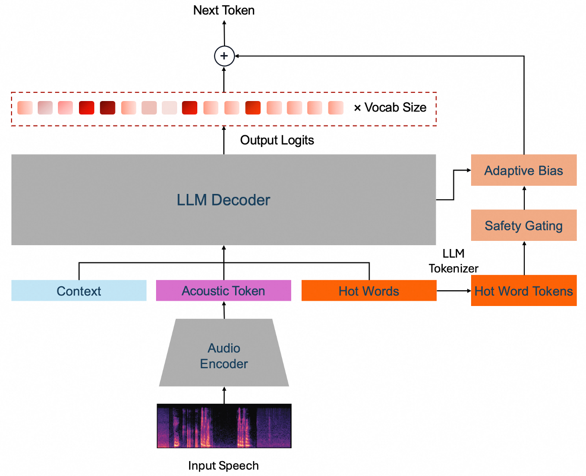
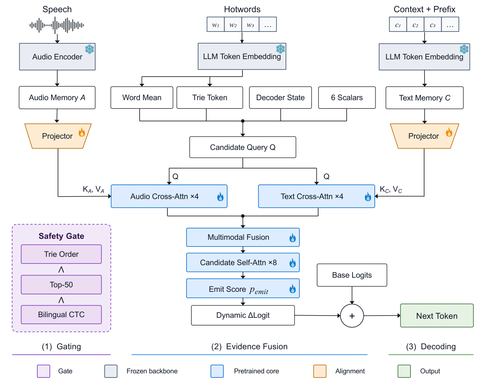

# HotBias: Hotword Biasing for ASR with Cross-Domain Generalization and Cross-Model Transfer.

HotBias adds a gated, token-level score to a frozen autoregressive ASR model. Its pretrained biasing core can be reused across ASR backbones by training only six target-specific input projections. This repository provides the core implementation, alignment and inference code for Fun-ASR-Nano-2512 and FireRedASR2-AED, and architecture figures.

<p align="center"></p>

*Figure 1. Overview of HotBias.*

<p align="center"></p>

*Figure 2. Safety gating and the hotword biasing module of HotBias. [Vector PDF](figures/hotbias_architecture.pdf).*

## Repository contents

| Path | Contents |
| --- | --- |
| [`hotbias/`](hotbias/) | Shared attention-fusion core and transfer utilities. |
| [`fun_asr_nano/`](fun_asr_nano/) | Fun-ASR-Nano initialization, training, inference, and evaluation. |
| [`firered_asr2_aed/`](firered_asr2_aed/) | FireRedASR2-AED initialization, training, and inference. |
| [`scripts/prepare_release_weights.py`](scripts/prepare_release_weights.py) | Verify and export the three audited, model-only checkpoints. |
| [`figures/`](figures/) | Overview and architecture figures. |
| [`docs/checkpoints.md`](docs/checkpoints.md) | Checkpoint identities, hashes, and compatibility. |
| [`docs/reproduction.md`](docs/reproduction.md) | Scope and differences between the reported setup and released artifacts. |

## Setup and checkpoints

Install the shared package from the repository root:

```bash
python -m pip install -e .
```

Use a separate environment compatible with each upstream ASR model. For Nano, obtain the original [Fun-ASR-Nano-2512 toolkit-format model](https://huggingface.co/FunAudioLLM/Fun-ASR-Nano-2512/tree/272c57b82523ada6fd87095e955f8e29100979ab) and [Fun-ASR code](https://github.com/QwenAudio/Fun-ASR); the converted `-hf` checkpoint is not interchangeable. For FireRed, obtain the [FireRedASR2S code](https://github.com/FireRedTeam/FireRedASR2S) and [FireRedASR2-AED model](https://huggingface.co/FireRedTeam/FireRedASR2-AED). Install their upstream dependencies before using the corresponding integration.

The three HotBias checkpoints are separate from the ASR models:

| Checkpoint | Use | Hugging Face link |
| --- | --- | --- |
| `source_transfer.pt` | Final Qwen3-based source core; initializes new target adapters. It is **not** a standalone ASR model. | |
| `nano_aligned.pt` | Completed Fun-ASR-Nano-2512 adapter from the 100-hour selected alignment run. | |
| `firered_aligned.pt` | Completed FireRedASR2-AED adapter. | |

Model files are not stored in this Git repository; Hugging Face links will be added to the table when available. Their SHA256 values and export procedure are in [Checkpoint details](docs/checkpoints.md). Users with the three original checkpoints can run [`prepare_release_weights.py`](scripts/prepare_release_weights.py) with an external `--output-dir` to create the model-only files. The paths below are placeholders for that external checkpoint directory.

## Inference

Run from the repository root. Repeat `--hotword` for each candidate; no reference transcript is used to select candidates.

Fun-ASR-Nano-2512 (CUDA):

```bash
python fun_asr_nano/infer.py \
  --model-dir /path/to/Fun-ASR-Nano-2512 \
  --nano-model-code /path/to/Fun-ASR/model.py \
  --checkpoint /path/to/hotbias-checkpoints/nano_aligned.pt \
  --audio /path/to/audio.wav \
  --hotword '池州' --hotword '赤州'
```

The `--nano-model-code` argument is needed if the installed FunASR environment has not registered Nano. By default, Nano uses token-Trie and raw-logit Top-50 gating. For the optional frozen character-CTC acoustic gate, add `--ctc-temporal-gate --ctc-model-dir /path/to/wav2vec2-ctc`; this CTC model is **not** one of the three HotBias checkpoints. See [Nano details](fun_asr_nano/README.md).

FireRedASR2-AED (CPU or CUDA):

```bash
python firered_asr2_aed/infer.py \
  --model-dir /path/to/FireRedASR2-AED \
  --firered-repo /path/to/FireRedASR2S \
  --checkpoint /path/to/hotbias-checkpoints/firered_aligned.pt \
  --audio /path/to/audio.wav \
  --hotword '池州' --hotword '赤州' \
  --device cuda:0
```

`--firered-repo` can be omitted when the official package is installed. This integration uses the raw-logit Top-50 and token-Trie gates; it does not use CTC or a native hotword prompt. Both inference commands print the unmodified baseline and HotBias transcripts.

## Align to a target backbone

Alignment freezes the ASR model and the transferred HotBias core, updating only six input projections. Supply authorized audio, transcripts, and candidate lists. A JSONL row usable by both examples is:

```json
{"id":"utt-001","audio_path":"audio/utt-001.wav","text":"请打开池州地图","asr_hotwords":["池州","赤州"],"hotwords":["池州","赤州"],"duration":3.2}
```

Nano reads `asr_hotwords`; FireRed reads `hotwords`. `duration` is in seconds. The reference text supervises training only; inference candidate selection is reference-independent.

For Fun-ASR-Nano, create an initialization checkpoint and selection manifest, then train. The example matches the eight-GPU, one-epoch alignment configuration:

```bash
python fun_asr_nano/initialize_adapter.py \
  --transfer-checkpoint /path/to/hotbias-checkpoints/source_transfer.pt \
  --output-checkpoint outputs/nano_init.pt
python fun_asr_nano/prepare_manifest.py \
  --train-jsonl /path/to/train.jsonl \
  --output outputs/nano_selection.json
torchrun --standalone --nproc_per_node=8 fun_asr_nano/train.py \
  --model-dir /path/to/Fun-ASR-Nano-2512 \
  --nano-model-code /path/to/Fun-ASR/model.py \
  --initial-checkpoint outputs/nano_init.pt \
  --selection-manifest outputs/nano_selection.json \
  --local-audio-root /path/to/audio-root \
  --output-dir outputs/nano_train \
  --epochs 1 --gradient-accumulation 8
```

For FireRedASR2-AED:

```bash
python firered_asr2_aed/initialize_adapter.py \
  --transfer /path/to/hotbias-checkpoints/source_transfer.pt \
  --output outputs/firered_init.pt
python firered_asr2_aed/train.py \
  --init outputs/firered_init.pt \
  --model-dir /path/to/FireRedASR2-AED \
  --firered-repo /path/to/FireRedASR2S \
  --manifest /path/to/train.jsonl \
  --output outputs/firered_train \
  --device cuda:0
```

The initialization files are **not** inference checkpoints. Completed training writes `checkpoint_final.pt` in the selected output directory. For Nano batch evaluation and additional path rules, see [fun_asr_nano/README.md](fun_asr_nano/README.md).

## Reproduction status

The code and separately distributed checkpoints support the **transfer method**, but this repository does not yet provide public checkpoint links, the original ASR backbones, or evaluation audio/manifests. The frozen source Qwen3-based recognizer is not included. Differences between the reported setup and the checkpoint settings are listed in [Reproduction notes](docs/reproduction.md). Do not treat the quick-start commands as an exact reproduction of reported results.

Run the backbone-independent checks with:

```bash
python -m pip install -e '.[dev]'
python -m pytest -q tests
```
